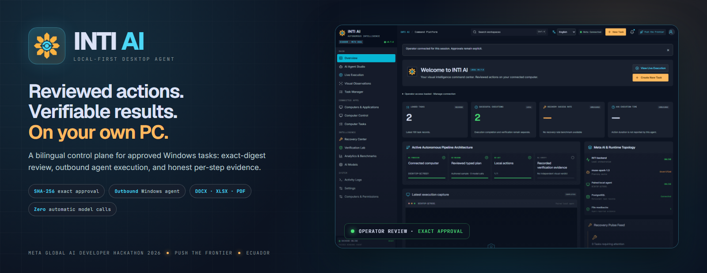
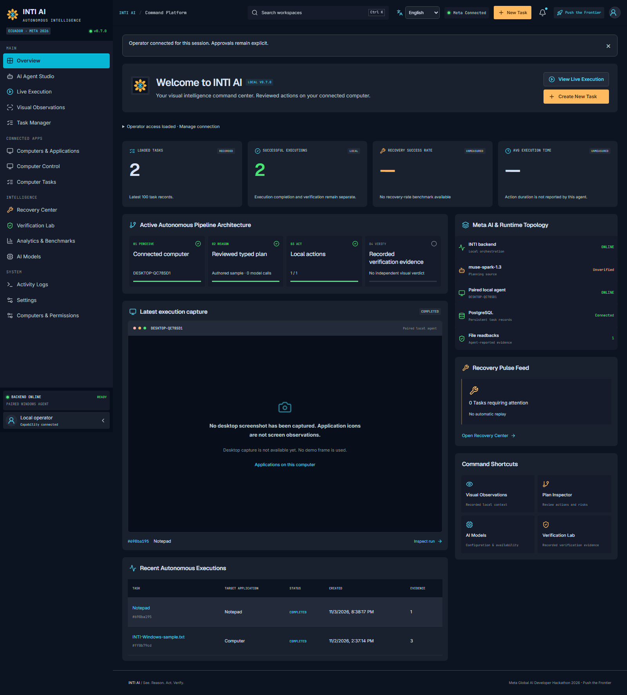
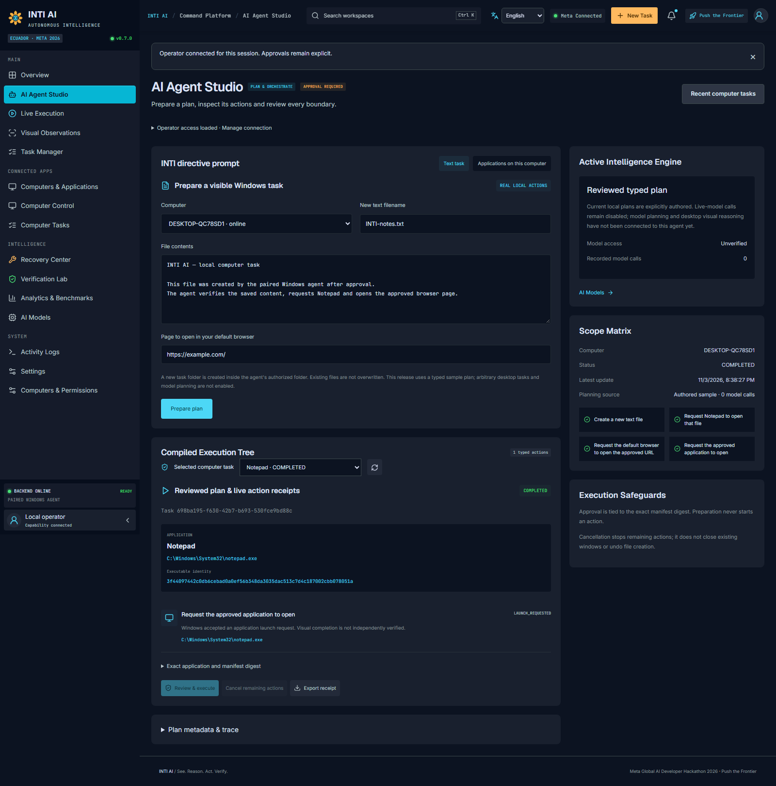
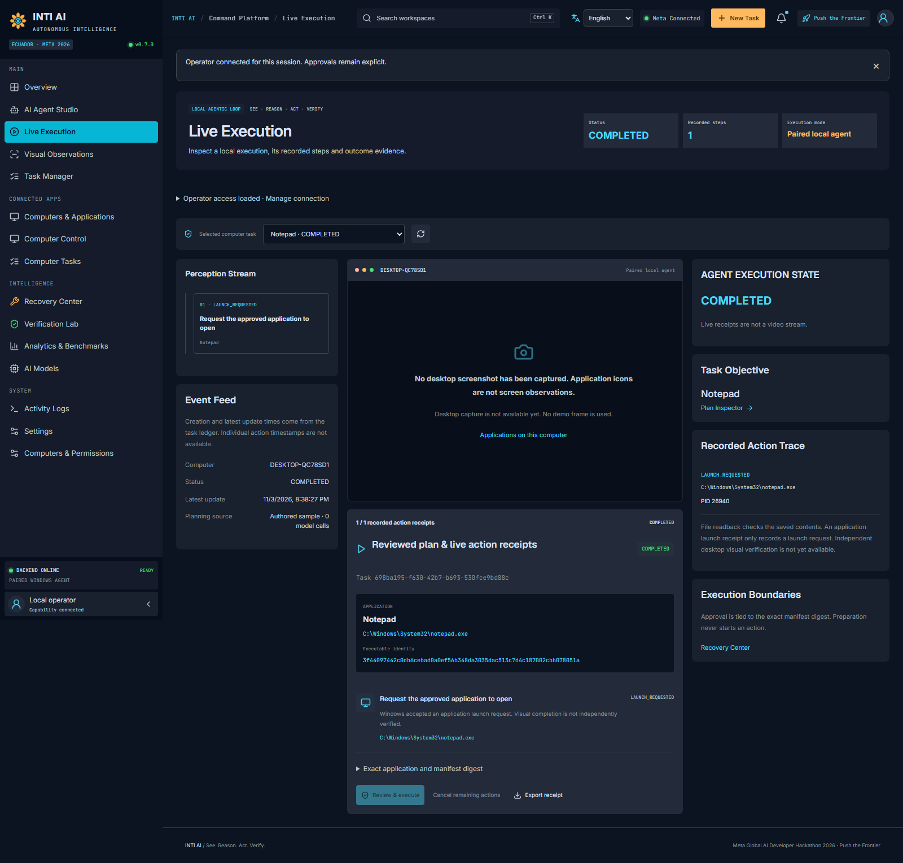
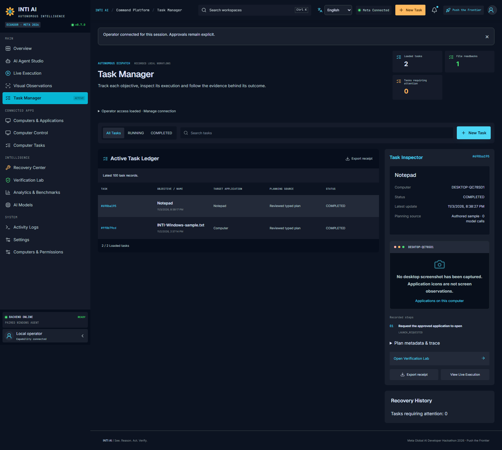
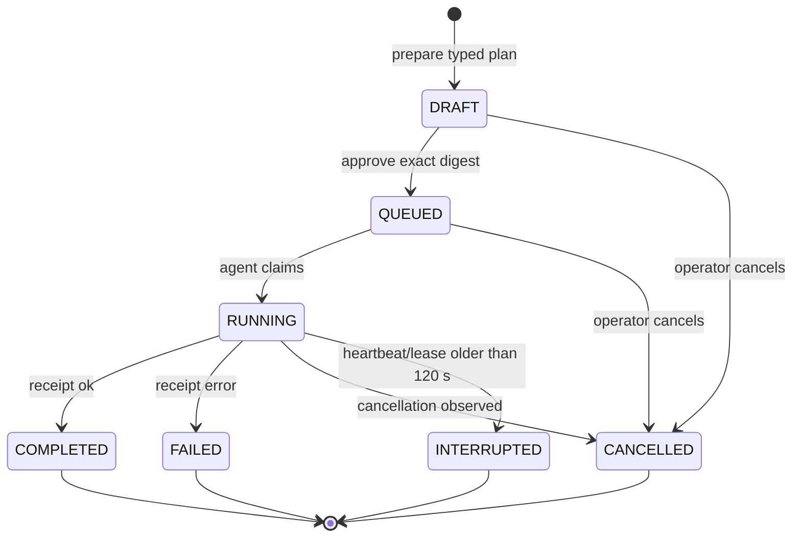
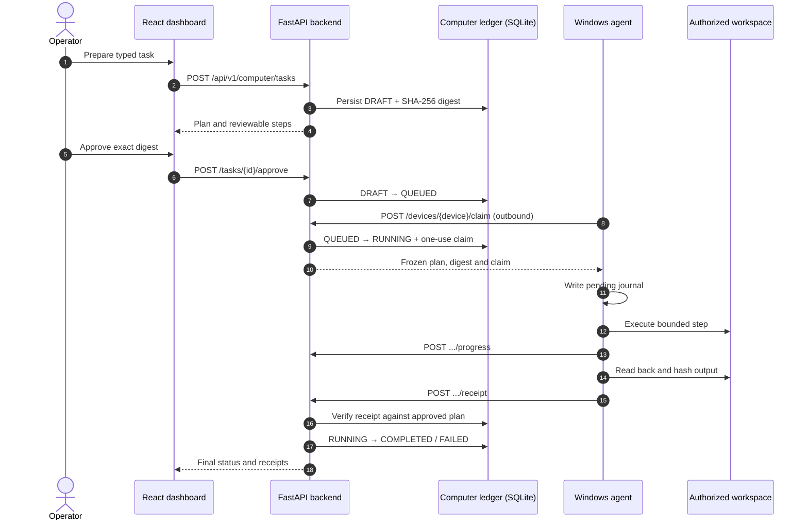
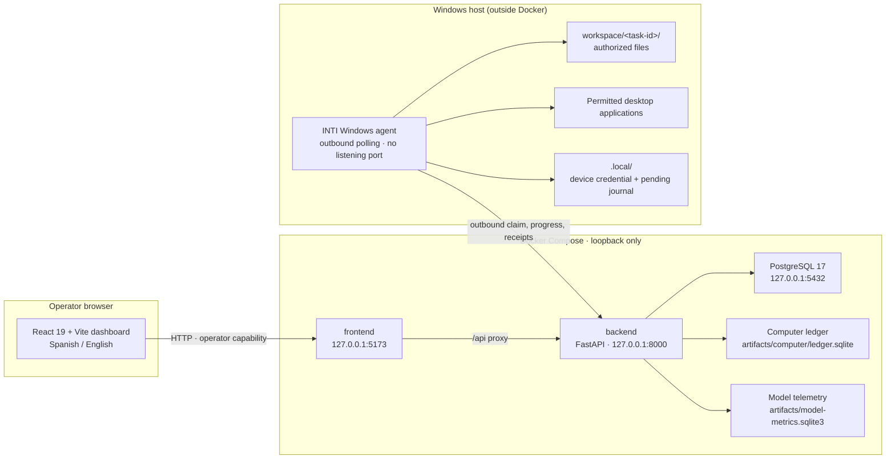
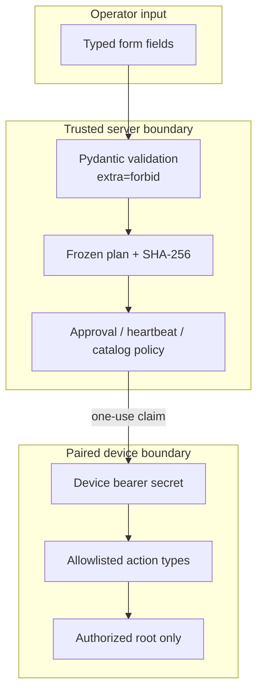

<p align="center">
  
</p>

<p align="center">
  
  
  
  
  
</p>

<p align="center">
  <a href="#quick-start">Quick start</a> ·
  <a href="#pair-a-windows-agent">Pair a Windows agent</a> ·
  <a href="#architecture">Architecture</a> ·
  <a href="#security-model">Security</a> ·
  <a href="#api-reference">API</a> ·
  <a href="#limitations-and-non-goals">Limitations</a> ·
  <a href="#resumen-en-español">Español</a>
</p>

---

INTI AI connects a bilingual web dashboard to an outbound-polling Windows agent. An
operator prepares a typed task, reviews the exact contents and approves a SHA-256
manifest digest. The agent claims the approved task, performs a bounded set of local
actions inside an authorized workspace, and returns per-step receipts. The dashboard
records what happened and distinguishes a verified file readback from a requested
application launch.

The project is a **local single-operator reference implementation**, built for the
Meta Global AI Developer Hackathon 2026. It is intentionally conservative: the
default runtime makes **zero model calls**, has no shell, no arbitrary executable
execution, no unrestricted keyboard or mouse control, and no automatic replay of
interrupted actions.

> **Current release:** `0.7.0` · Default Compose runtime: `local_computer` · UI: Spanish and English.

## Table of contents

- [What INTI AI does](#what-inti-ai-does)
- [Product tour](#product-tour)
- [Demo film](#demo-film)
- [How it works](#how-it-works)
- [Architecture](#architecture)
- [Quick start](#quick-start)
- [Pair a Windows agent](#pair-a-windows-agent)
- [Guided local workflow](#guided-local-workflow)
- [Document dossier](#document-dossier)
- [Application launch permissions](#application-launch-permissions)
- [Model measurements](#model-measurements)
- [Security model](#security-model)
- [API reference](#api-reference)
- [Configuration](#configuration)
- [Data and persistence](#data-and-persistence)
- [Project layout](#project-layout)
- [Development and testing](#development-and-testing)
- [Operations and recovery](#operations-and-recovery)
- [Limitations and non-goals](#limitations-and-non-goals)
- [Documentation](#documentation)
- [Resumen en español](#resumen-en-español)
- [License](#license)

## What INTI AI does

Modern desktop automation usually fails in one of two ways: it breaks silently when
an interface changes, or it reports success without proving the outcome. INTI AI
separates **preparation**, **authorization**, **execution**, **evidence**, and
**recovery** into explicit, inspectable steps.

The table below describes the default `local_computer` runtime. The optional legacy
inventory sandbox has a different feature set and is documented separately.

| Capability | Status | What the system actually does |
|---|---|---|
| Reviewed text task | Implemented | Creates a new `.txt` file in a fresh task folder, reads it back, verifies SHA-256, requests Notepad and the default browser. |
| Application launch | Implemented | Detects compatible desktop executables, requires explicit per-application permission, and requests a no-argument launch after exact plan approval. |
| Document dossier | Implemented | Produces a Word quotation, Excel budget, PDF quotation, summary and manifest with readback checks. |
| Durable task ledger | Implemented | Persists draft, approval, claim, progress and terminal receipts; no automatic replay after interruption. |
| Operator approvals | Implemented | Approval is bound to the exact plan digest and a live paired device. Changing the plan invalidates the approval path. |
| Bilingual dashboard | Implemented | Spanish and English UI, with the preference stored in the browser. Task contents and identifiers remain exactly as entered. |
| Model telemetry | Implemented | Local latency/throughput/calibration measurements and an explicit, operator-triggered calibration call. |
| Desktop screenshot capture | Not implemented | Visual Observations states the limitation and does not fabricate local desktop evidence. |
| Visual model reasoning | Not implemented | No screenshot is captured or sent for local-computer tasks. |
| Independent visual verification | Not implemented | Launch receipts mean “launch requested”, not “window observed” or “page loaded”. |
| Natural-language desktop planning | Not implemented | The current release uses explicitly authored, typed plans. |
| macOS / Linux agent | Not implemented | The agent currently executes on Windows only. |
| Multi-user access control | Not implemented | One shared operator capability; no RBAC, SSO or tenant isolation. |

### Design principles

1. **Review before action.** A plan is inert until the operator approves its exact
   content hash.
2. **Typed, not generated.** Plans are Pydantic models with `extra="forbid"`.
   Unknown fields and unsupported operations are rejected.
3. **Local by default.** Compose publishes services on loopback only. The agent
   polls outbound and opens no listening control port.
4. **Evidence over optimism.** File readback, application launch requests, and
   independent visual confirmation are separate concepts.
5. **Fail closed.** Stale devices, stale catalogs, revoked credentials, changed
   executables and interrupted tasks do not silently continue.
6. **No hidden replay.** The agent journals before execution and never repeats an
   action automatically after an outage.

## Product tour

<table>
  <tr>
    <td width="50%"></td>
    <td width="50%"></td>
  </tr>
  <tr>
    <td align="center"><sub><b>Overview</b> — runtime state, workflow and recent activity</sub></td>
    <td align="center"><sub><b>AI Agent Studio</b> — typed task and document composer</sub></td>
  </tr>
  <tr>
    <td width="50%"></td>
    <td width="50%"></td>
  </tr>
  <tr>
    <td align="center"><sub><b>Live Execution</b> — approvals, claims and step receipts</sub></td>
    <td align="center"><sub><b>Task Manager</b> — durable ledger and focused inspector</sub></td>
  </tr>
</table>

Additional visual references are available in
[`docs/screenshots/`](docs/screenshots) and in the
[restored tab design notes](docs/RESTORED-TAB-DESIGNS.md).

### Dashboard routes

The main navigation remains available in both runtimes. In `local_computer` mode,
the data comes from the paired-device ledger and application catalog.

| Route | Section | Purpose in local mode |
|---|---|---|
| `/` | Overview | Runtime topology, workflow status, recent tasks and shortcuts. |
| `/planning` | AI Agent Studio | Compose text tasks, document dossiers and application launches. |
| `/execution` | Live Execution | Prepare, review, approve and follow task progress. |
| `/observations` | Visual Observations | Device context and catalog; desktop capture is explicitly unavailable. |
| `/tasks` | Task Manager | Search and inspect the durable task ledger. |
| `/inventory` | Computers & Applications | Paired devices and the searchable application catalog. |
| `/computer` | Computer Control | Focused local-computer control surface. |
| `/computer/tasks` | Computer Tasks | Local task history. |
| `/computer/permissions` | Computers & Permissions | Pairing, device revocation and application permissions. |
| `/recovery` | Recovery Center | Prepare a fresh reviewed draft after interruption; never auto-replay. |
| `/verification` | Verification Lab | Explain what evidence exists and what remains unverified. |
| `/benchmarks` | Analytics & Benchmarks | Local runtime metrics; unavailable measurements stay empty. |
| `/models` | AI Models | Model configuration, telemetry and explicit calibration. |
| `/activity` | Activity Logs | Local activity records. |
| `/system` | Settings | Access, configuration and service status. |

The interface language can be switched in the top bar. Spanish is the initial
language, and the preference is stored in the browser. Entered task contents, file
names, paths, URLs and exported API identifiers are not translated.

## Demo film

<p align="center">
  
</p>

The project includes a **131.43 s (2:11)** produced film that demonstrates the
real local runtime: English narration, synchronized Spanish captions, 1920×1080
at 30 fps. It records one actual document task for the fictitious quotation
`INTI-EC-104` — form entry, a required email validation error, correction,
exact-digest approval, six agent actions, five saved files and a reviewed total
of **USD 5,462.50**.

The film is a demonstration of this repository, not a separate prototype. Its
runtime, workflow, document pipeline and model-calibration scene match the
architecture and guarantees documented here. Production sources and renders are
intentionally outside Git; the committed record is the stills under
[`docs/assets/readme/`](docs/assets/readme) and the full notes in
**[`docs/DEMO-FILM.md`](docs/DEMO-FILM.md)**, including honest scope: Word/Excel
views are extracted content, not Office recordings, and the model scene is a
single calibration sample, not a benchmark.

## How it works

### The operator workflow

1. **Connect.** Enter the private operator capability in the dashboard. It is kept
   in React state and disappears on reload.
2. **Inspect context.** Verify the paired computer, authorized workspace and agent
   heartbeat.
3. **Prepare.** Choose a text task, document dossier or permitted application and
   fill in a typed form.
4. **Review.** Inspect the exact file name, contents, URL, document inputs or
   application path/identity, plus the manifest digest.
5. **Approve.** Approval applies to that digest only. A stale device, a changed
   catalog or a modified plan blocks approval.
6. **Execute.** The agent claims the queued task on its next outbound poll.
7. **Observe.** The dashboard receives monotonic progress and a final receipt.
8. **Recover deliberately.** If a task is interrupted, prepare a new draft and
   review it again. Nothing is replayed automatically.

### Task state machine



The task ledger is durable. A `RUNNING` task whose progress is older than
**120 seconds** becomes `INTERRUPTED`. Revocation cancels every pending or running
task for that device. Terminal tasks are not restarted by the server.

### End-to-end sequence



### Approval and receipt guarantees

- The digest is computed over the canonical JSON representation of the frozen plan.
- The server checks the submitted digest against the stored plan and an active
  device heartbeat before transitioning to `QUEUED`.
- Progress is append-only. An agent cannot replace previously recorded steps.
- A success receipt is checked against the approved plan: step IDs, order, status,
  path, content hash, byte count, URL, application ID and identity as applicable.
- Receipt statuses have precise meanings:

| Receipt status | Meaning |
|---|---|
| `VERIFIED_READBACK` | The agent wrote data and independently read it back and hashed it. |
| `LAUNCH_REQUESTED` | The agent asked Windows to open an application, file or URL. Completion is not visually certified. |
| `VALIDATED` | The agent validated typed inputs before generating documents. |

## Architecture

### Runtime topology



The default Compose stack has **three services**: PostgreSQL, backend and frontend.
The Windows agent is intentionally not containerized: it runs on the computer whose
files and applications are being acted upon, outside Docker, and connects outbound
to the backend.

### Components

| Component | Technology | Responsibility |
|---|---|---|
| Dashboard | React 19, TypeScript, Vite, React Query | Bilingual operator console, task composition, approvals, receipts, ledger, model telemetry. |
| API | FastAPI, Pydantic v2 | Operator and device protocols, schema validation, exact-digest approval, error envelope, OpenAPI. |
| Computer ledger | SQLite | Pairing codes, devices, tasks, claims, progress, receipts and application permissions. |
| Application database | PostgreSQL 17 | Durable application data used by the backend; health-checked by Compose. |
| Windows agent | Python 3.12+, httpx | Outbound polling, local journal, path confinement, text/document generation, application launch. |
| Document engine | python-docx, openpyxl, reportlab | Fixed-name DOCX/XLSX/PDF output plus summary and manifest. |

### Trust boundaries



The browser is not trusted to assert who approved a task: the operator identity is
resolved from server configuration, and the device identity is resolved from its
bearer capability. Secrets never appear in API responses.

## Quick start

### Prerequisites

- Windows 10/11 for the local agent.
- Docker Desktop with **Linux containers** enabled.
- Python 3.12+ and internet access on the Windows host for the agent's first launch.
- Free loopback ports `5173`, `8000` and `5432`.

### 1. Start the stack

From the repository root:

```powershell
powershell -ExecutionPolicy Bypass -File .\scripts\start_computer.ps1
```

The script:

1. checks that Docker is available;
2. creates `.env` from `.env.example` if needed;
3. generates a random `EXECUTION_OPERATOR_TOKEN` when the current value is empty or
   shorter than 24 characters;
4. builds and starts the three-service Compose stack and waits for health checks.

Use `-SkipBuild` when the images are already built. On a network with a private
certificate authority, pass a trusted PEM bundle:

```powershell
powershell -ExecutionPolicy Bypass -File .\scripts\start_computer.ps1 -BuildCaPem .\.tmp\corporate-ca.pem
```

TLS verification remains enabled; the PEM is used during builds and mounted
read-only for provider requests.

### 2. Open the dashboard and connect

Open <http://localhost:5173>. Copy `EXECUTION_OPERATOR_TOKEN` privately from the
ignored `.env` file into **Operator capability** in the dashboard.

The capability is held in browser memory only and is cleared on reload. Never commit
`.env`, paste the token into a shared document, or include it in screenshots.

### 3. Pair the Windows agent

Follow [Pair a Windows agent](#pair-a-windows-agent), then use **Computer Control**
to prepare and approve the first task.

### Manual Compose startup

```powershell
Copy-Item .env.example .env
# Set a private EXECUTION_OPERATOR_TOKEN of at least 24 characters.
docker compose up --build -d
docker compose ps
```

All published ports bind to `127.0.0.1`. Remote access is not enabled by default;
see [Security model](#security-model) before exposing the API.

## Pair a Windows agent

1. In the dashboard, open **Computers & Permissions** and connect with the operator
   capability.
2. Download `inti-local-agent.zip` from the dashboard, or directly from the frontend
   at <http://localhost:5173/downloads/inti-local-agent.zip>.
3. Extract the ZIP into a folder owned by your Windows user. Do not extract it into
   a shared or administrator-owned location.
4. Run the launcher:

   ```powershell
   powershell -ExecutionPolicy Bypass -File .\Start-INTI-Agent.ps1
   ```

   The launcher creates a private virtual environment, installs dependencies and
   starts the agent. Python 3.12+ is required.
5. Generate a one-use pairing code in **Computers & Permissions**. Enter it when the
   agent prompts for it.
6. Keep the agent running. Its extracted `workspace` folder is the only root in
   which new task files may be created.

For a backend on another computer, pass its origin explicitly:

```powershell
powershell -ExecutionPolicy Bypass -File .\Start-INTI-Agent.ps1 -Backend https://inti.example.com
```

Remote backends must use HTTPS. Plain HTTP is accepted only for loopback
(`localhost`, `127.0.0.1`, `::1`). Deploy the backend behind a TLS-terminating proxy
and restrict access before using a remote host.

### Pairing details

| Property | Behavior |
|---|---|
| Pairing code | Generated by an authenticated operator; 300-second lifetime; single use. |
| Device credential | Random secret returned once at enrollment; stored hashed in the ledger. |
| Agent state | `.local/computer-agent.json`; keep it private. |
| Pending journal | `.local/computer-agent.pending.json`; written before execution. |
| Workspace | `workspace/<task-id>/...`, created fresh for each approved task. |
| Heartbeat | Device considered offline for planning/approval after 30 seconds without a poll. |
| Revocation | Blocks future claims and cancels `DRAFT`, `QUEUED` and `RUNNING` tasks. |

When updating an agent, keep its existing `.local` credentials and `workspace`.
A fresh installation must be paired again.

## Guided local workflow

### Text file, Notepad and browser

In **Computer Control**:

1. Select the paired computer.
2. Enter a simple `.txt` filename and the exact contents.
3. Enter an absolute `http(s)` page URL.
4. Click **Prepare plan**.
5. Review the frozen steps, target paths and SHA-256 digest.
6. Approve the exact digest, then watch the agent claim and execute the task.

The agent:

1. creates `workspace/<task-id>/<filename>` with exclusive-create semantics;
2. writes UTF-8 content, flushes it, reads it back and compares SHA-256 and bytes;
3. requests `notepad.exe` to open that exact file;
4. requests the default browser to open the approved URL;
5. returns one receipt per step and journals progress before/after each action.

File readback is verified by the agent. Notepad and browser receipts mean the launch
was requested; the dashboard does not claim that a window became visible or that a
page loaded successfully.

### What is rejected

- Path separators, absolute paths or reserved Windows device names in the filename.
- Content larger than 16,000 characters.
- URLs with embedded credentials, whitespace, control characters or non-HTTP(S)
  schemes.
- Unknown plan fields, unsupported step IDs or receipts that do not match the
  approved plan.
- Approval when the device is offline, revoked or no longer matches the workspace.
- Replacing previously recorded progress or replaying an interrupted execution.

## Document dossier

**AI Agent Studio → Documents** prepares a structured quotation package from a
typed form: customer, contact, city, issue/validity dates, an explicit tax rate in
basis points, one to eight line items, and optional notes.

| Output | Format | Verification performed by the agent |
|---|---|---|
| `cotizacion.docx` | Word | Reopens the document and checks the rendered fields. |
| `presupuesto.xlsx` | Excel | Checks formulas, cached results, chart and reconciliation sheet. |
| `cotizacion.pdf` | PDF | Checks document structure and output hash. |
| `resumen.txt` | Plain text | Matches the approved structured summary exactly. |
| `manifest.json` | JSON | Binds every output file to the approved plan digest. |

The output folder is a fresh task UUID beneath the paired root. The pipeline refuses
to reuse an existing task folder and never overwrites previous work. Money is
calculated in integer cents; tax uses the entered basis-point rate with half-up
rounding. The default tax rate is a configurable example, **not tax advice**.

Preparation grants no execution. The same exact-digest approval, device claim,
cancellation and no-replay rules apply. No application is launched, no document is
signed or emailed, no external service is called, and Office UI control is not
implied.

The agent host must have `python-docx`, `openpyxl` and `reportlab`. Use the current
source-only agent ZIP or install the backend's `agent` extra. Existing agent
installations must update and restart to recognize document tasks.

See [Document workflow](docs/DOCUMENT-WORKFLOW.md) for the full contract.

## Application launch permissions

The agent publishes a catalog of compatible desktop applications. Detection alone
grants nothing.

1. Open **Applications on this computer** for the selected device.
2. Search by name and inspect the executable path.
3. Explicitly authorize the application.
4. Prepare an application launch. This creates a draft, not an execution.
5. Review the exact application name, path, identity and digest, then approve it.
6. The agent rediscovers the entry immediately before launching it without arguments.

Catalog rules:

- The catalog refreshes approximately every **30 seconds** and expires after
  **90 seconds**.
- Permissions are tied to the executable's identity: canonical path, size,
  modification time and file identity.
- A changed executable resets its permission and cancels affected pending plans.
- Revoking or removing permission cancels pending launches but does not close an
  application that is already open.
- Store applications, shortcuts that require arguments, symlinks/reparse points and
  known console interpreters are excluded.
- The catalog is a compatibility list, not a complete inventory of installed
  software.

An application launch receipt is a `LAUNCH_REQUESTED` event. It does not prove that
the application finished loading, and permission to open an application does not
grant control over its contents. See [Applications](docs/APPLICATIONS.md).

## Model measurements

The default local workflow is fully authored and makes **zero model calls**.
Introspection routes such as `GET /api/v1/models/status` never contact the provider.

Model telemetry is stored locally in `artifacts/model-metrics.sqlite3`, limited to
the latest 200 logical requests for the configured model. It records numeric
measurements only — no request content, image, credential or generated text.

| Metric | Meaning |
|---|---|
| Latency | Mean end-to-end duration of successful requests, including network, normal retry/backoff and response validation. Not GPU inference time or time-to-first-token. |
| Throughput | Provider-reported output tokens divided by elapsed time for successful requests with usage counters. Missing usage remains unknown. |
| Localization | Fraction of valid synthetic calibration responses that land inside a known target. A narrow hit-rate check, not proof of real desktop grounding precision. |
| GPU memory | Unavailable: this client has no provider GPU telemetry. |

The explicit calibration control asks for confirmation and then calls
`POST /api/v1/models/evaluate` with `{"confirm_real_call": true}`. It sends one
generated 512×320 PNG with a green target and requests a pixel coordinate. It has no
automatic retries, caps output at 512 tokens, and **can consume provider quota**.
It never captures the desktop or sends a local file.

A configured key is not proof of access; access is marked available only after a
valid response. Changing the key requires backend recreation. See
[Model measurements](docs/MODEL-MEASUREMENTS.md).

## Security model

### Core controls

| Area | Control |
|---|---|
| Operator authentication | Shared secret `EXECUTION_OPERATOR_TOKEN`, compared with `secrets.compare_digest`; minimum 24 characters. |
| Browser handling | Capability kept in React state, not persisted to storage; cleared on reload. |
| Device authentication | Per-device random secret, stored hashed; every claim/progress/receipt requires it. |
| Pairing | One-use code, 300-second expiry, platform restricted to `win32`. |
| Exact approval | SHA-256 digest over canonical plan JSON; approval requires matching digest and active device. |
| Plan validation | Frozen Pydantic models with `extra="forbid"` and discriminated task kinds. |
| File confinement | Fresh UUID folder under the paired root; no path components from user input; symlink/reparse rejection. |
| File creation | Exclusive create (`O_EXCL`), no-follow where supported, `0600` mode, flush and readback. |
| Application control | Explicit per-device permission, identity pinning, fresh rediscovery immediately before no-argument launch. |
| Execution surface | Fixed action types only. No shell, deletion, arbitrary executable, keyboard or mouse injection. |
| Network posture | Outbound agent polling; no listening control port. HTTP only on loopback; remote agents require HTTPS. |
| Exposure | Compose binds `5173`, `8000` and `5432` to `127.0.0.1`. CORS defaults to loopback origins. |
| Replay prevention | Durable claim, append-only progress, pending journal, `INTERRUPTED` state, no automatic retry. |
| TLS | Certificate verification stays enabled; optional private CA bundle is supplied explicitly. |

### What this model does not provide

INTI AI is not hardened for hostile multi-tenant use. It does not provide RBAC, SSO,
per-user audit separation, encrypted-at-rest guarantees beyond the host, rate
limiting, WAF protection or a secure remote deployment by default. The operator
capability is a shared secret. The computer ledger is a local SQLite database in the
backend artifact volume. If you expose the service beyond loopback, place it behind
an authenticated TLS reverse proxy and apply your own network and host controls.

The agent runs with the privileges of the Windows user who starts it. It can act on
files and applications that user can access. The workspace confinement applies to
new task files; it does not sandbox the operating system.

## API reference

Base URL: `http://127.0.0.1:8000/api/v1`<br />
Interactive OpenAPI: <http://127.0.0.1:8000/docs>

The local task ledger uses UUID identifiers and Unix epoch-second timestamps. Validation
errors use FastAPI's standard `422` shape. Application errors use:

```json
{"error": {"code": "COMPUTER_REQUEST_REJECTED", "message": "Safe operator-readable message"}}
```

### Public and operator routes

| Method | Route | Auth | Behavior |
|---|---|---|---|
| `GET` | `/health` | Public | Liveness and version. |
| `GET` | `/system/status` | Public | Backend, database and runtime readiness. Browser is reported unavailable in local mode. |
| `GET` | `/capabilities` | Public | Runtime mode and feature switches; never exposes secrets. |
| `GET` | `/models/status` | Public | Configuration and last verified model availability; no provider call. |
| `POST` | `/models/evaluate` | Operator | Explicit synthetic calibration call; requires `{"confirm_real_call": true}`. |
| `POST` | `/computer/pairing` | Operator | Create a one-use pairing code. |
| `GET` | `/computer/state` | Operator | Devices and the latest 100 tasks; reports zero model calls. |
| `POST` | `/computer/tasks` | Operator | Prepare a typed text/browser task. |
| `POST` | `/computer/document-tasks` | Operator | Prepare a structured document dossier. |
| `POST` | `/computer/application-tasks` | Operator | Prepare a one-step application launch draft. |
| `POST` | `/computer/tasks/{id}/approve` | Operator | Approve the exact plan digest and enqueue it. |
| `POST` | `/computer/tasks/{id}/cancel` | Operator | Cancel a draft, queued or running task. |
| `POST` | `/computer/devices/{id}/revoke` | Operator | Revoke a device and cancel its active tasks. |
| `GET` | `/computer/applications/{device_id}` | Operator | Read the device's application catalog and permissions. |
| `POST` | `/computer/applications/{device_id}/{app_id}/permission` | Operator | Grant or remove permission for an executable identity. |

### Device protocol routes

Authenticated with `Authorization: Bearer <device-secret>` unless noted.

| Method | Route | Behavior |
|---|---|---|
| `POST` | `/computer/enroll` | Exchange a one-use pairing code for a device ID and secret. No bearer required. |
| `POST` | `/computer/devices/{device_id}/claim` | Mark heartbeat and claim the oldest queued task. |
| `GET` | `/computer/devices/{device_id}/tasks/{id}` | Check current status and digest before each step. |
| `POST` | `/computer/devices/{device_id}/tasks/{id}/progress` | Append ordered, monotonically growing step receipts. |
| `POST` | `/computer/devices/{device_id}/tasks/{id}/receipt` | Submit the terminal result; validated against the approved plan. |
| `POST` | `/computer/devices/{device_id}/applications` | Publish or refresh the application catalog. |

> `docs/API.md` documents the optional legacy inventory sandbox routes, including
> browser execution, recovery and verification. Those routes are mounted only when
> `INTI_RUNTIME_MODE=inventory_sandbox`.

## Configuration

Settings are loaded from `.env` in the working directory; environment variables take
precedence. Docker Compose also supplies values directly.

| Variable | Default | Purpose |
|---|---|---|
| `INTI_RUNTIME_MODE` | `local_computer` in Compose and `.env.example` | Selects `local_computer` or the optional `inventory_sandbox`. |
| `EXECUTION_OPERATOR_TOKEN` | Generated by `start_computer.ps1` | Shared operator capability. Must be at least 24 characters. |
| `POSTGRES_PASSWORD` | `inti` (development default) | PostgreSQL password. Set a unique value outside a disposable local demo. |
| `DATABASE_URL` | Local PostgreSQL URL | SQLAlchemy connection string. Compose overrides the host to `postgres`. |
| `ARTIFACT_DIR` | `artifacts` | Backend artifact root; Compose mounts the `artifacts` volume at `/app/artifacts`. |
| `META_API_KEY` | empty | Optional Meta provider key for explicit calibration or legacy model features. |
| `META_MODEL_ID` | `muse-spark-1.3` | Provider model identifier. Use one enabled for your account. |
| `MISSION_MODEL_CALLS_ENABLED` | `false` | Disables mission model planning. The explicit calibration route is separate. |
| `CORS_ORIGINS` | Loopback dashboard origins | JSON array of allowed browser origins. |

Technical limits (content size, planning steps, timeouts, artifact sizes, concurrency)
are defined with validated bounds in
[`apps/backend/src/inti/infrastructure/config/__init__.py`](apps/backend/src/inti/infrastructure/config/__init__.py).
`POSTGRES_PASSWORD=inti` is a development default, not a production credential.
Existing PostgreSQL volumes keep the password set during first initialization.

## Data and persistence

| Data | Location | Notes |
|---|---|---|
| Computer task ledger | `artifacts/computer/ledger.sqlite` | Pairing, devices, tasks, progress and application permissions. Inside the `artifacts` Compose volume. |
| Model telemetry | `artifacts/model-metrics.sqlite3` | Numeric measurements only; latest 200 logical requests. |
| Backend artifacts | `artifacts/` | Persistent Compose volume; can contain task-related metadata. |
| PostgreSQL data | `postgres-data` named volume | Application database. |
| Agent credential | `<agent>/.local/computer-agent.json` | Private device secret; never share. |
| Agent pending journal | `<agent>/.local/computer-agent.pending.json` | Written before actions; used to report interruption without replay. |
| Task workspace | `<agent>/workspace/<task-id>/` | New files only; no overwrite. |
| Operator token | `.env` (ignored) + browser memory | Never commit or export it with evidence. |

Do not delete volumes to troubleshoot a task. Back up the database and artifacts
together when preserving history.

## Project layout

```text
.
├── apps/
│   ├── backend/                 FastAPI service, domain, computer ledger, Windows agent
│   │   ├── src/inti/
│   │   │   ├── domain/          Frozen plans, document contracts, validation
│   │   │   ├── infrastructure/  Configuration, computer store, model telemetry
│   │   │   ├── presentation/    Operator API and device protocol
│   │   │   ├── local_agent.py   Outbound Windows agent
│   │   │   ├── local_applications.py
│   │   │   └── local_documents.py
│   │   └── tests/               Unit and integration tests
│   ├── frontend/                React 19 dashboard and bilingual UI
│   └── demo-app/                Optional legacy inventory sandbox fixtures
├── docs/                        Architecture, workflows, evidence and screenshots
├── scripts/                     Startup, agent packaging, verification helpers
├── benchmarks/                  Recorded benchmark reports
├── docker-compose.yml           Default three-service local runtime
├── docker-compose.legacy.yml    Optional six-service inventory sandbox
└── .env.example                 Documented local configuration template
```

## Development and testing

### Native prerequisites

- Python 3.12+
- Node.js 22+ and npm
- Docker Desktop for the Compose path
- Playwright Chromium only if running legacy browser tests

### Install

```powershell
python -m venv .venv
.\.venv\Scripts\Activate.ps1
python -m pip install -e "apps/backend[dev]"
npm --prefix apps/frontend ci
```

### Run checks

```powershell
python -m pytest apps/backend/tests -m "not e2e"
python -m ruff check apps/backend scripts
python -m ruff format --check apps/backend scripts
python -m mypy --config-file apps/backend/pyproject.toml apps/backend/src

npm --prefix apps/frontend run lint
npm --prefix apps/frontend run typecheck
npm --prefix apps/frontend test
npm --prefix apps/frontend run build
```

The repository also includes a `Makefile` with `setup`, `dev`, `test`, `lint` and
`build` targets. The GitHub Actions workflow is configured to run backend lint, type
checking, non-E2E tests with coverage, the policy benchmark, and the full frontend
check suite on Ubuntu with Python 3.12 and Node 22.

### Rebuild the agent ZIP

The downloadable ZIP is generated from an explicit source allowlist and contains no
credentials, local state or task artifacts:

```powershell
python scripts/package_local_agent.py
```

Run this after changing the agent, document support or command schema. The source
archive is written to `apps/frontend/public/downloads/inti-local-agent.zip`.

### Optional legacy inventory sandbox

The historical browser execution, recovery and verification implementation is
preserved under [`docs/README.inventory.md`](docs/README.inventory.md). Start it with:

```powershell
powershell -ExecutionPolicy Bypass -File .\scripts\start_demo.ps1
```

It uses `docker-compose.legacy.yml` and six services. Do not run both runtimes under
the same Compose project or simultaneously on the same ports. Its fixture-based model
results are not live-model evaluations, and it is not the default local-computer path.

## Operations and recovery

### Stop the stack

From the repository root:

```powershell
docker compose down
```

This stops and removes the containers but preserves the named PostgreSQL and artifact
volumes. Do **not** add `-v` unless you intentionally want to destroy the database,
ledger, telemetry and artifacts.

### Stop the agent

Press `Ctrl+C` in the agent console. Existing files and application windows remain.
The agent does not delete work on shutdown.

### Cancel a task

Cancellation stops remaining actions and marks the task `CANCELLED`. Files created by
earlier steps are retained. An already opened application is not closed.

### Revoke a device

Revocation invalidates its secret, blocks future claims and cancels `DRAFT`, `QUEUED`
and `RUNNING` tasks for that device. Re-pairing creates a new device identity.

### Handle an interruption

If the server lease expires or an acknowledgement is rejected, the task becomes
`INTERRUPTED`. The agent will **not** replay it. Before manually archiving
`.local/computer-agent.pending.json`, stop the agent and inspect the journal and the
task folder. A missing receipt does not prove that an action did not occur.

Recovery Center prepares a fresh draft that requires a new review and approval. It
never automatically repeats an interrupted action.

## Limitations and non-goals

INTI AI is deliberately narrow. The following are **not** claimed or implemented in
this release:

- Arbitrary natural-language desktop tasks or autonomous desktop planning.
- Shell commands, PowerShell execution, process control, file deletion or arbitrary
  executable launch.
- Unrestricted keyboard or mouse control.
- Desktop screenshot capture, visual model reasoning or independent visual outcome
  verification for local-computer tasks.
- Control over the contents of a launched application.
- Document signing, email delivery, external service calls or Office UI automation.
- macOS or Linux agents.
- Multi-user RBAC, SSO, tenant isolation or a hardened public deployment.
- Production-grade high availability, horizontal scaling or multi-worker safety.
- GPU telemetry, comparative model benchmarks or claims of model quality.
- Automatic replay, automatic repair or silent retry of uncertain effects.

The local workflow is an authored sample and document pipeline, not a general-purpose
agent. The UI displays unavailable measurements as unavailable rather than filling
them with demo data.

## Documentation

| Document | Contents |
|---|---|
| [Local computer](docs/LOCAL-COMPUTER.md) | Current runtime context, screenshots, validation and caveats. |
| [Demo film](docs/DEMO-FILM.md) | Produced 2:11 film, what it demonstrates, and its honest scope. |
| [Document workflow](docs/DOCUMENT-WORKFLOW.md) | Dossier inputs, outputs, verification and limitations. |
| [Model measurements](docs/MODEL-MEASUREMENTS.md) | Telemetry definitions, calibration behavior and privacy. |
| [Applications](docs/APPLICATIONS.md) | Discovery rules, permission semantics and launch limits. |
| [Restored tab designs](docs/RESTORED-TAB-DESIGNS.md) | Per-route visual composition and local data sources. |
| [Architecture](docs/FINAL-ARCHITECTURE.md) | Detailed architecture, state and trust boundaries. |
| [API](docs/API.md) | Legacy inventory sandbox REST/WebSocket contracts. |
| [Development](docs/DEVELOPMENT.md) | Extended development, migration and testing notes. |
| [Inventory sandbox README](docs/README.inventory.md) | Optional historical six-service runtime. |
| [Screenshots](docs/screenshots) | Desktop, bilingual, workflow and evidence captures. |

## Resumen en español

INTI AI es un panel web bilingüe conectado a un agente de Windows que consulta al
servidor mediante conexiones salientes. El operador prepara una tarea tipada, revisa
su contenido exacto y aprueba un hash SHA-256. El agente reclama la tarea, ejecuta
acciones acotadas dentro de una carpeta autorizada y devuelve recibos por cada paso.

**Lo principal:**

- **Aprobación exacta:** cada tarea se aprueba contra el digest de su plan. Si el plan,
  el dispositivo o el catálogo cambian, la aprobación falla.
- **Sin shell ni ejecución arbitraria:** no hay comandos de sistema, borrado de
  archivos, control libre de teclado/ratón ni ejecutables arbitrarios.
- **Agente saliente:** el agente no abre puertos de control y solo se conecta al
  backend. En remoto exige HTTPS.
- **Evidencia honesta:** `VERIFIED_READBACK` significa que el archivo se releyó y
  verificó; `LAUNCH_REQUESTED` solo significa que se solicitó abrir una aplicación,
  archivo o URL.
- **Sin reproducción automática:** una tarea interrumpida queda `INTERRUPTED` y
  requiere un nuevo borrador revisado.
- **Documentos:** genera cotización DOCX, presupuesto XLSX, cotización PDF, resumen y
  manifiesto con nombres fijos y sin sobrescribir trabajo anterior.
- **Cero llamadas automáticas a modelos:** el flujo local usa planes escritos por el
  operador. La calibración opcional se ejecuta solo con confirmación explícita y puede
  consumir cuota del proveedor.
- **Límites claros:** no hay captura de pantalla del escritorio, razonamiento visual
  local, verificación visual independiente ni agentes para macOS/Linux.

**Video de demostración:** el film de 2:11 (131.43 s) muestra el flujo real de
`INTI-EC-104` — validación, aprobación exacta, seis acciones, cinco archivos y un
total revisado de USD 5,462.50. Narración en inglés con subtítulos en español. Los
detalles y el alcance honesto están en [`docs/DEMO-FILM.md`](docs/DEMO-FILM.md).

**Inicio rápido:** ejecuta `.\scripts\start_computer.ps1`, abre
<http://localhost:5173>, copia `EXECUTION_OPERATOR_TOKEN` desde `.env` en **Operator
capability**, descarga el agente desde **Computers & Permissions**, ejecuta
`Start-INTI-Agent.ps1` y empareja con un código de un solo uso.

La documentación técnica está en inglés; la interfaz y este resumen están en español.

## License

Released under the [MIT License](LICENSE).

INTI AI was built for the **Meta Global AI Developer Hackathon 2026**, **Push the
Frontier**, Indie Developer track. It is an independent reference implementation, not
a production deployment or an official Meta product.
