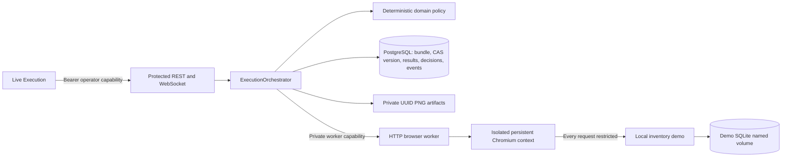
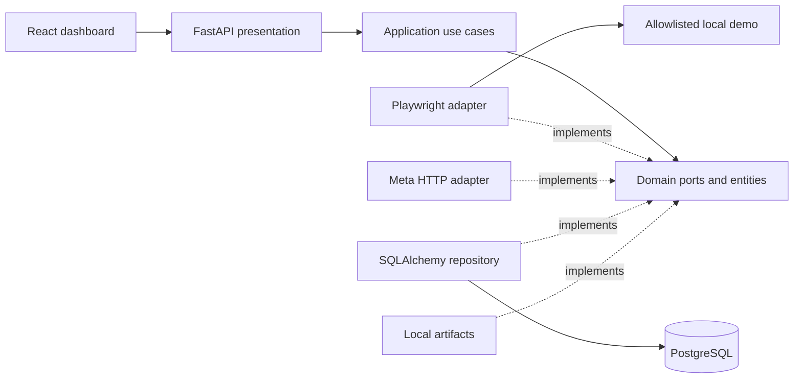
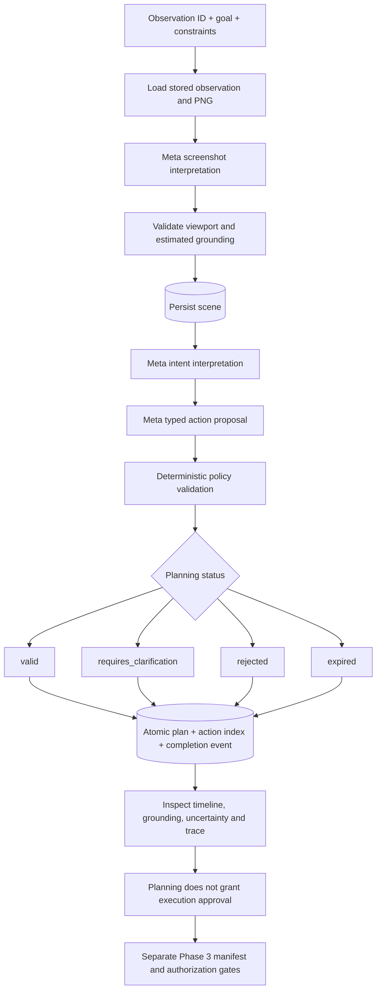

# Architecture

Current milestone: Phase 3, authorized sandbox execution. Phase 1 observation and
Phase 2 planning are preserved.

## Phase 3 execution boundary

`ExecutionRepositoryPort`, `BrowserSessionPort` and `ActionExecutorPort` separate
orchestration from SQL, RPC and Playwright. `execution_policy.py` converts a frozen
validated planning result and exact typed operator contracts into a manifest.
SHA-256 covers the entire plan snapshot, action IDs, parameters, bindings, checks,
grounding mode, viewport, URL and limits. Integral floats normalize across JSON
round trips. Changes invalidate approval. The original plan is checked again on
start, resume and every action cycle. LOW/MEDIUM require plan approval; HIGH actions
need a second exact-action confirmation. PROHIBITED actions cannot be approved.

Business uncertainty remains blocking. The adapter may accept a conditional Phase 2
plan only when its clarification findings describe runtime grounding/checkpoints:
unresolved, stale or future controls, option checks, low confidence or disabled
targets. Every action still requires approved typed pre/postconditions and fresh
runtime evidence; disabled, ambiguous, missing or offscreen controls fail closed.
This does not convert business assumptions into authorization.

The orchestrator persists a RUNNING action record before dispatch, executes once,
captures the resulting PNG and stores immediate check outcomes. DOM resolution
records exact accessible role/name; selector mode intersects an approved data-testid
with that semantic target. Visual mode requires fresh model coordinates, unchanged
screenshot digest and session-bound evidence; there is no coordinate fallback.
Visual mode supports URL assertions and coordinate click/type; DOM assertions and
select-option are explicitly unsupported in that mode. It remains unverified with
a real Meta model in this environment. Hybrid DOM is the verified demo mode.

Each result distinguishes `action_executed`, `postconditions_satisfied`, and
`may_have_executed`. Immediate checks briefly observe asynchronous application
effects within the action timeout; dispatch is never repeated. The Phase 3 engine
never sets `overall_goal_verified=true`. An independent test reads the application
store and opens a new browser to certify the demonstration outcome.

One backend process owns its asynchronous schedulers. Database compare-and-swap
versions protect mutations and results/events/decisions commit atomically. Startup
marks abandoned RUNNING/PAUSED executions FAILED/PROCESS_RESTART and revokes browser
sessions; it never replays actions. Multi-process scheduling is unsupported. Artifact
writes precede metadata commits with compensation; a crash can leave an orphan PNG.
Cancellation records terminal state, interrupts supported pending work, revokes the
worker session and records an uncertain outcome when interruption obscures effects.
It cannot undo an application commit. Worker TTL bounds cleanup after lost transport.

Events share the transaction with execution state. An indexed monotonic sequence
supports REST `after` replay and WebSocket reconnect. Clients deduplicate UUIDs and
retain a sequence cursor; REST polling continues if the socket is unavailable.
The socket accepts the operator capability in its first frame, never the URL.

Compose puts the worker only on an internal network shared with backend/demo. It
receives no Meta key or database URL, exposes no host port, drops capabilities,
disallows privilege escalation and uses a read-only root with temporary storage,
768 MiB memory and 256 PID limits. Chromium receives an environment whitelist.
All HTTP resources enforce exact demo origin, allowed methods and bounded main-frame
navigation; redirects, frames, popups, downloads and WebSockets are blocked.
This is a trusted local synthetic sandbox boundary, not a general public browsing service.
The legacy observation adapter remains separate and continues using fresh contexts.

Defaults: 30 actions, 180 seconds including pauses, 10 seconds/action, 5 MB/PNG,
2 contexts, 3 navigations including initial load, 5-second evidence freshness and
180-second session inactivity TTL. Application scheduling and worker caps are separate.
Container memory/PID limits are shared by the whole worker. No durable queue,
automatic recovery or automatic non-idempotent retry exists.

Dependencies point inward: presentation → application → domain. Infrastructure
implements domain ports. Domain imports only the Python standard library.
The composition root wires concrete adapters in `presentation/dependencies`.

Domain entities use dataclasses and explicit invariant validation, independent of
Pydantic. Legacy `Task` contracts remain compatible. Phase 3 execution entities,
policies and ports live in `domain/execution*`; `ExecutionSession` owns explicit transitions.
Ports are structural Python protocols, enabling typed adapters and test doubles.

Application capture persists metadata after browser capture and removes the PNG
if database persistence fails. This is compensation, not a distributed transaction:
a process crash between the two writes can leave an orphan artifact. Analyze
retrieves an existing observation, calls the vision port and persists the result.
No provider response is fabricated. Analysis failure does not overwrite a prior
successful result. Status probes the database schema and launches/closes Chromium.

Infrastructure stores PNG bytes under UUID-only names, never URL-derived paths.
SQLAlchemy sync sessions run in worker threads; no request-scoped session is shared
across concurrent operations. Database migrations are explicit Alembic revisions;
the server never silently creates tables. Compose migrates before startup.

SOLID: each adapter has one external responsibility; new providers implement ports;
all implementations satisfy the same contracts; browser, vision, repository and
storage ports are separate; application dependencies are injected abstractions.
API schemas map entities to safe public references, hiding ORM rows and paths.

The browser opens fresh isolated contexts and closes the browser in `finally`.
Two captures may run concurrently per server process. Every HTTP resource request
is checked for the exact target origin. Every navigation must match an exact
configured URL; HTTP redirects are refused before following their destinations. Service workers and
websocket egress are blocked; screenshots include the bounded viewport only.
Allowlist hostnames are limited to loopback or the Compose `demo` service.
This application-level restriction assumes a trusted local demo/network; use OS
egress isolation before allowing untrusted pages or configurable remote targets.

The frontend uses TanStack Query for actual backend state, Router for navigation,
and component state for editable instructions. Mutations invalidate relevant
queries. Screenshots use backend same-origin proxy references. UI statuses do not
derive from synthetic metrics. Analysis text is rendered as text, never raw HTML.

Tradeoffs: no queue, no distributed lock, one local operator, short history window,
no authentication. PostgreSQL is required in the live stack; SQLite is only an
isolated repository/API test fixture. A filesystem and database backup must remain
consistent. Production hardening and autonomous actions are out of Phase 1 scope.

## Reasoning and planning extensions

`domain/planning.py` contains framework-independent dataclasses for viewport,
bounding boxes, visual elements/scenes, task intent, action targets/parameters,
planned actions, plans, findings, usage and events. `planning_ports.py` isolates
reasoning, intent, planning, grounding, policy, repository and telemetry behavior.
No action executor is defined or injected into planning use cases.

Generation composes scene interpretation, task interpretation, plan proposal and
deterministic validation within one total timeout. The original goal/constraints
are retained even if the model tries to rewrite them. Visual and planning Meta
adapters share the Phase 1 authenticated transport, retries, timeout, response cap
and usage normalization. Wire schemas/JSON codecs stay outside the domain.

Visual grounding checks screenshot identity, viewport and estimated box bounds.
All model-based results explicitly say model_visual or unresolved. DOM-assisted
claims are rejected because no independent DOM matcher is implemented. Confidence
is uncalibrated; valid bounds do not prove correct localization.

The deterministic policy enforces parameter allowlists, known target references,
element types, visible/enabled state, preconditions, expected evidence, URL scope,
unsafe-operation restrictions and fresh-observation checkpoints. High-risk steps
carry future-human-approval findings. Expiry is based on screenshot/plan age.
`valid` is a planning judgment, never an execution authorization.

The plan repository shares the existing SQLAlchemy engine. `visual_scenes` stores
scene snapshots; `action_plans` stores complete inspection results;
`planned_actions` indexes ordered action type/risk; `planning_events` stores
prompt-free correlated traces. Plan, action index and completion event commit in
one transaction. Revalidation updates the same plan row and appends an event.
Failure events before a plan exists remain correlated by task/request in logs/DB.

This remains local synchronous HTTP orchestration, not a durable job queue.
Generation is non-idempotent: repeated requests create distinct plans and can
incur additional inference cost. Revalidation is state-idempotent and intentionally
appends audit events. Cancellation stops coroutine orchestration, but cannot
forcibly interrupt a database write already running in a worker thread.
