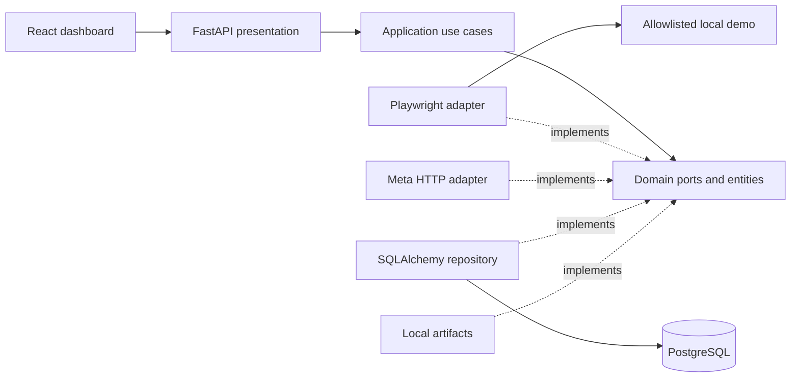

# Architecture

Dependencies point inward: presentation → application → domain. Infrastructure
implements domain ports. Domain imports only the Python standard library.
The composition root wires concrete adapters in `presentation/dependencies`.

Domain entities use dataclasses and explicit invariant validation, independent of
Pydantic. `Task` restricts transitions; action/execution/verification contracts are
future-facing data contracts, not claims that action orchestration exists.
Ports are structural Python protocols, enabling typed adapters and test doubles.

Application capture persists metadata after browser capture and removes the PNG
if database persistence fails. This is compensation, not a distributed transaction:
a process crash between the two writes can leave an orphan artifact. Analyze
retrieves an existing observation, calls the vision port and persists the result.
No provider response is fabricated. Analysis failure does not overwrite a prior
successful result. Status probes the database schema and launches/closes Chromium.

Infrastructure stores PNG bytes under UUID-only names, never URL-derived paths.
SQLAlchemy sync sessions run in worker threads; no request-scoped session is shared
across concurrent operations. Database migrations are explicit Alembic revisions;
the server never silently creates tables. Compose migrates before startup.

SOLID: each adapter has one external responsibility; new providers implement ports;
all implementations satisfy the same contracts; browser, vision, repository and
storage ports are separate; application dependencies are injected abstractions.
API schemas map entities to safe public references, hiding ORM rows and paths.

The browser opens fresh isolated contexts and closes the browser in `finally`.
Two captures may run concurrently per server process. Every HTTP resource request
is checked for the exact target origin. Every navigation must match an exact
configured URL; HTTP redirects are refused before following their destinations. Service workers and
websocket egress are blocked; screenshots include the bounded viewport only.
Allowlist hostnames are limited to loopback or the Compose `demo` service.
This application-level restriction assumes a trusted local demo/network; use OS
egress isolation before allowing untrusted pages or configurable remote targets.

The frontend uses TanStack Query for actual backend state, Router for navigation,
and component state for editable instructions. Mutations invalidate relevant
queries. Screenshots use backend same-origin proxy references. UI statuses do not
derive from synthetic metrics. Analysis text is rendered as text, never raw HTML.

Tradeoffs: no queue, no distributed lock, one local operator, short history window,
no authentication. PostgreSQL is required in the live stack; SQLite is only an
isolated repository/API test fixture. A filesystem and database backup must remain
consistent. Production hardening and autonomous actions are out of Phase 1 scope.
