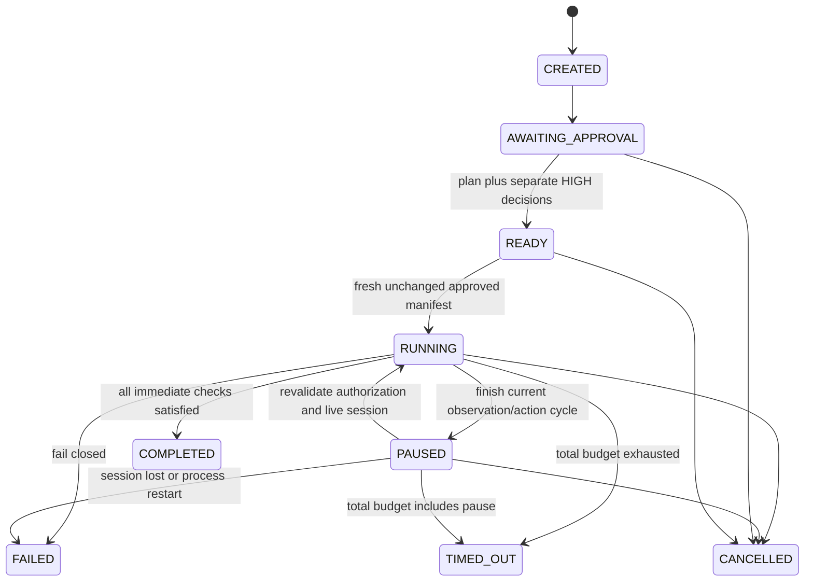

# INTI AI — Software Design Document

Version 0.5.0 · Phase 5 · Ecuador · Meta Global AI Developer Hackathon 2026

## Phase 3 implementation

Scope: PLAN → AUTHORIZE → ACT → OBSERVE → RECORD. The Phase 1 and Phase 2 sections
below describe their original design; current execution boundaries are specified
in [Architecture](ARCHITECTURE.md) and measured in [Phase 3 report](PHASE-03-REPORT.md).

Domain contracts: ExecutionSession, ExecutionStatus, ExecutableAction,
ActionExecutionResult, BrowserSession, ExecutionEvent and AuthorizationDecision.
Typed checks cover visibility, enabled state, input value, selected option, exact
text and URL. Supported dispatch types are click, type_text, select_option, scroll,
navigate, wait, inspect and verify. No user/model-supplied executable scripts exist.

CREATED may also cancel. READY may fail for abandoned-start handling; all terminal
states reject further transitions. Duplicate starts are rejected. Every allowed
and forbidden state pair is covered by a parameterized test. Approvals are separate
records bound to exact manifest digests and server operator identity. The demo recipe
is visibly authored, never a substitute for an unavailable model response.

Data migration 0003 adds five execution tables and private-observation classification.
Screenshots stay in artifact storage. Historical observation and planning rows survive
upgrade; downgrade tests use temporary databases only. Execution runs on one backend
process, with an isolated private worker and persisted events, not a durable job queue.

Acceptance evidence includes real browser actions, SQLite writes, PostgreSQL events,
private screenshots, authorization controls, pause/resume/cancel, failure/timeout
tests, responsive UI and independent store/fresh-browser verification. The engine
records immediate outcomes; full autonomous recovery and a reusable goal verifier
are outside Phase 3. A real Meta-derived end-to-end run remains blocked by credentials.

## System overview

INTI (Intelligent Navigation, Task Execution & Interaction) establishes the
perception foundation of PERCEIVE → REASON → ACT → VERIFY → RECOVER. Its target
problem is brittle UI automation. Phase 1 captures authorized visual evidence and
can submit it for real model reasoning, without executing actions.

## Requirements

Functional: observe the local synthetic inventory; persist timestamp, source,
title, viewport and artifact reference; retrieve observations and images;
optionally interpret a screenshot through Meta; show actual system diagnostics;
provide usable loading, empty, error and successful states in the dashboard.

Nonfunctional: framework-independent domain, explicit typed boundaries,
async-safe resource ownership, bounded navigation/model timeouts, no secrets in
public responses, restricted local access, repeatable development environment,
lint/type checks, >80% measured domain/application test coverage, honest evidence.

## Components and dependency rules

Domain: `Task`, `Observation`, `AgentAction`, `ExecutionResult`,
`VerificationResult`, `VisionAnalysis`; enums and safe domain exceptions;
browser, vision, repository and artifact protocols. No framework imports.

Application: `CaptureObservationUseCase`, `AnalyzeObservationUseCase`,
`GetSystemStatusUseCase`. Dependencies are domain contracts only. Domain return
objects serve as application DTOs; unused placeholder packages are omitted.

Infrastructure: `ConfigurationProvider` (Pydantic Settings),
`PlaywrightBrowserAdapter`, `MetaModelAPIAdapter`,
`SQLAlchemyObservationRepository`, `LocalArtifactStorage`.

Presentation: FastAPI routes, Pydantic schemas, DI container, safe error mapping.
No ORM/browser objects cross the API. Full dependency discussion is in
[ARCHITECTURE](ARCHITECTURE.md).

## Domain model and persistence

Observation is immutable, UUID identified, timezone-aware, HTTP sourced and bounded
to width 320–1920 and height 240–1080. VisionAnalysis contains model, summary,
visible elements, state and response ID. Task moves pending → running → completed
or failed; terminal transitions are forbidden. Future action contracts require
nonempty targets/details/evidence.

`observations` stores ID, UTC timestamp, source URL, title, viewport, UUID artifact
name, analysis status, and optional normalized response metadata. PNG bytes remain
on disk. Revision `0001` adds the table and timestamp index. Analysis status is
`not_analyzed` or `completed`; in-flight/error states are request-local in Phase 1.
Retries do not create fabricated success records.

## API and data flow

See [API](API.md) for endpoint contracts and examples.

Capture: dashboard POST → request validation → capture use case → Chromium →
allowlisted demo → viewport PNG → artifact storage → PostgreSQL metadata → safe
observation response → same-origin image request → screenshot viewer.

Analysis: observation ID → repository lookup → artifact bytes → documented Meta
image request → validated completion + strict JSON payload → normalized domain
analysis → database update → structured UI display.

## Security and errors

Secrets are environment-only and use redacted SecretStr configuration fields.
`.env`, artifacts and virtualenv are ignored. CORS allows only explicit dashboard
origins. Compose binds exposed services to loopback. Requests forbid extra fields;
UUID references prevent user-selected file access. Artifact symlinks are rejected.
Browser resource requests/redirects are restricted, service workers/websockets
blocked. No user/model JavaScript evaluation, shell execution, or destructive
action endpoint exists. The demo's normal first-party JavaScript is allowed.

Domain errors map to 404 (missing), 422 (navigation policy), 503 (missing Meta
configuration), or 502 (upstream/browser/database failure). Unexpected failures
return a generic 500. Validation returns FastAPI's documented 422 detail list.
Provider bodies, headers, and credentials are never copied into public errors.
The Meta adapter retries only transport failures, 429 and selected 5xx responses,
at most three attempts, within one total request timeout. Long Retry-After values
fail rather than retry too early. Both seconds and HTTP-date Retry-After values
are supported. Status availability reflects only the last call.

The deployment is for a trusted local operator, with no authentication. Before
remote use: authentication, authorization, quotas, OS egress policies and security
review are required. No production readiness claim is made.

## Testing strategy

Unit tests validate entity invariants, transitions, use case behavior and mocked
port substitution. Integration tests cover artifacts, SQLAlchemy roundtrips,
HTTP request payloads, retries, errors and API schemas using isolated fixtures.
Real E2E tests launch Chromium, visit the demo and exercise PostgreSQL-backed
REST capture/retrieval. A separate UI acceptance script checks PNG decoding,
reload persistence, navigation and mobile overflow and writes screenshots.
Frontend component tests cover empty/loading/error/observation/capture states.
CI uses mocks for model requests and requires no production API credentials.
Measured results and exceptions belong in [PHASE-01-REPORT](PHASE-01-REPORT.md).

## Phase 2 design extension

Phase 2 covers PERCEIVE → REASON → PLAN. Observation contracts/routes are preserved
with version 0.2.0. No generated navigation, click, typing or selection is executed.
New domain types model viewport/coordinates, visual elements/scenes, intent,
typed targets/parameters/actions/plans, validation findings, model usage and events.
Normalized coordinates use Meta's documented 0–1000 grid; pixels are validated
against the captured viewport. Finite/positive coordinates and unique IDs are
required. Allowed statuses are draft, valid, requires_clarification, rejected,
expired. No execution status or transition exists.

Three Meta stages use strict JSON schemas with required object fields and
additionalProperties=false. Invalid JSON, unsupported actions, incomplete
completions and invalid boxes fail explicitly. Intent distinguishes explicit
requirements, assumptions, unverified inferences and ambiguities; these are
model-reported distinctions, not independent semantic truth. Screenshot-only
adapters cannot claim DOM assistance.

Deterministic policy checks types, parameters, target references, visible/enabled
state, preconditions, expected postconditions, evidence criteria, URLs, unsafe
payload patterns and fresh-observation checkpoints. Confidence cannot override
policy. Text evidence criteria are required but not executed or semantically
proven complete. Typed unsafe plans persist as rejected; malformed model output
fails before plan creation. Uncertain targets require clarification. Plans expire
relative to screenshot age, even when generated from a newly interpreted scene.

Planning endpoints and UI use backend/persisted state. Mocked responses exist only
in explicitly labeled automated tests. Generation bounds duration, retries,
steps, output tokens and response bytes. Structured events record correlation,
task/plan UUIDs, timestamps, model/response identifiers and supplied token/retry
metadata. No sensitive prompts, keys or provider error bodies are logged. Goals
and scene/plan snapshots persist locally as task data for user inspection.

Alembic 0002 adds four FK-linked tables without altering Phase 1 records or
duplicating screenshots. Upgrade/downgrade preservation is tested in isolation;
PostgreSQL upgrade is checked separately. Plan/action/completion persistence is
transactional. History is offset/limit paginated. Redis and distributed frameworks
remain unnecessary. Wonder and SAM are not integrated because no measured need
or verified account entitlement justifies them. See [Phase 2 report](PHASE-02-REPORT.md).

## Phase 4-5 implemented extension (0.5.0)

The lifecycle now includes bounded recovery and independent verification. Recovery
retains original objective/approval scope and resumes only after the original
interrupted action checks pass. Changed repair scope needs renewed digest and HIGH
authorization. Live model recovery remains unverified under the user's no-call scope.

The independent verifier defines and versions explicit criteria, uses fresh
read-only application snapshots plus isolated browser evidence, validates provenance
and SHA-256, evaluates nine deterministic assertion types and publishes a tri-state
verdict. It does not receive an action-executor port. Execution completion cannot
set the verdict. Optional unknown criteria remain visible. Six recovery tables and
six verification tables are additive migrations 0004/0005.

See [Recovery engine](RECOVERY-ENGINE.md), [verification engine](VERIFICATION-ENGINE.md),
[evidence model](EVIDENCE-MODEL.md) and [Phase 5 report](PHASE-05-REPORT.md) for actual
semantics, tests, benchmark denominators and remaining limitations.
