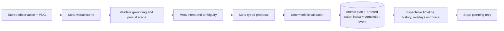

# INTI AI — Phase 2 implementation report

Date: 2026-10-28, America/Bogota. Version: 0.2.0.

## 1. Executive summary

Implemented the planning-only extension on the existing Phase 1 codebase:
screenshot scenes, typed visual elements, task intent, action decomposition,
deterministic policy validation, persisted plans/history/events and an AI Planning
workspace. No action executor, generated click/type/navigation dispatch or Execute
button exists. Existing observation remains functional.

**The live multimodal acceptance criterion remains BLOCKED:** no META_API_KEY is
configured. The real adapter paths are implemented; their contracts and successful
orchestration were verified using explicitly labeled test fixtures. No real Muse
Spark interpretation, planning accuracy, token use or latency is claimed.

## 2. Repository audit findings

- Started from the existing clean, published Phase 1 tree; no unrelated files were
  overwritten. Read README, SDD, architecture and Phase 1 report, domain ports,
  Meta/browser adapters, persistence, API composition and frontend Query/Router setup.
- Baseline executed: **37 backend unit/integration tests passed**, **5 frontend
  tests passed**, frontend build passed, **3 real observation E2E tests passed**.
- PostgreSQL, demo, backend and frontend were running healthy. Original domain was
  framework-independent; application/browser/artifact/repository ports were reusable.
- Missing Phase 2 components were actual absence, not broken Phase 1 placeholders:
  no scene/intent/action-plan domain, planning persistence/routes/workspace or benchmarks.
- Existing local URL/CORS restrictions, UUID artifacts, redirect blocking and
  synthetic-only demo were preserved. No essential Phase 1 repair was needed.
- Compatibility updates: application/package versions made consistently 0.2.0;
  shared Meta transport now accepts nested usage details, bounds decoded response
  size and handles compressed HTTP responses without double decoding. Existing
  analysis request/response contracts remain compatible.
- Migration 0002 was required. PostgreSQL had six observations before upgrade;
  all six remained after upgrade, before new verification captures were created.

## 3. Deliverable classification

| Deliverable | Status and evidence |
|---|---|
| Domain scene/element/intent/action/plan contracts | IMPLEMENTED AND VERIFIED: invariants, coordinates, enum/status restrictions |
| Visual interpretation adapter | IMPLEMENTED AND VERIFIED against explicit HTTP fixtures; live inference BLOCKED |
| Task interpretation/decomposition adapters | IMPLEMENTED AND VERIFIED against explicit fixtures; real model quality NOT VERIFIED |
| Grounding bounds/provenance | IMPLEMENTED AND VERIFIED; semantic pixel localization IMPLEMENTED BUT NOT VERIFIED |
| Uncertainty/clarification/risk policy | IMPLEMENTED AND VERIFIED by domain, API and regression scenarios |
| Deterministic plan validation | IMPLEMENTED AND VERIFIED; confidence never overrides structural/policy rejection |
| Persistence/history/traceability | IMPLEMENTED AND VERIFIED in SQLite and isolated real PostgreSQL schema |
| Planning frontend | IMPLEMENTED AND VERIFIED by component tests and real-browser fixture visualization |
| Automated tests and offline scenarios | IMPLEMENTED AND VERIFIED; results below |
| Live Meta integration test/benchmark harness | IMPLEMENTED BUT NOT VERIFIED; explicit opt-in required, credentials BLOCKED |
| Optional Wonder, SAM and DOM matcher | NOT IMPLEMENTED; no measured need or verified access justifies them |
| Model-generated UI execution/recovery | NOT IMPLEMENTED, intentionally deferred to Phase 3 |

## 4. Files created or modified

New backend source: `domain/planning.py`, `planning_policy.py`, `planning_ports.py`;
`application/context.py`, `application/planning.py`; infrastructure `grounding.py`,
`meta/planning.py`, `persistence/planning.py`; `presentation/planning_api.py`;
Alembic `0002_planning.py` and planning unit/integration/E2E test modules.

Modified backend source/configuration: shared Meta adapter, configuration,
composition root, main/correlation middleware, versioned health/status, package
metadata, Alembic environment/config, Docker dependency caching, tests/fixtures.

New frontend source: `pages/PlanningPage.tsx`, `features/planning/{SceneViewer,
PlanTimeline,PlanInspector}.tsx`, typed planning contracts/service, planning CSS
and component tests. Updated sidebar/routes, shared Axios export and versions.

New tooling: `scripts/benchmark_planning.py`, `scripts/verify_planning_workspace.py`,
12 JSON benchmark scenarios and measured offline JSON report. Updated CI, Makefile,
Compose, environment example and all required technical documentation. Complete
original-source inventory is in [FILE-MANIFEST](FILE-MANIFEST.txt); Phase 2-specific
changes are listed in [PHASE-02-FILES](PHASE-02-FILES.txt).

## 5. Domain, architecture and workflow

Framework-independent dataclasses represent finite, bounded pixel/normalized-1000
boxes, visible elements/provenance, scenes, intent distinctions, typed parameters,
actions, plans, findings, usage and events. No execution status is accepted.

Six application use cases implement scene/intent interpretation, generation,
validation, get and list. Adapters implement separate reasoning/planning ports but
share authentication, HTTP transport and error handling. The existing SQLAlchemy
engine and artifact storage are reused. No new framework/dependency was added.

The original user goal/constraints are retained for policy checks. After proposed
state changes, later interactions require new observation and re-grounding.
Unseen dropdown options remain explicit clarification requirements. Common
inspection/read-only constraints reject proposed mutations. High-risk steps have
future-human-approval findings. Expiry uses the screenshot age; interpreting an
old screenshot does not make its evidence fresh.

## 6. Model integration status

Rechecked official Meta documentation for authentication, endpoint, models, image
input, normalized coordinates, structured schemas, errors, rate limits and image
size constraints. See [integration record](META-INTEGRATION.md) for primary sources.
Primary: `muse-spark-1.3`, `POST https://api.meta.ai/v1/chat/completions`, Bearer
authentication, base64 PNG image input and strict JSON-schema output.

Three stages: image → scene; explicit scene/goal → intent; intent/scene → proposed
actions. Invalid JSON, unsupported enums, invalid coordinates, incomplete/refused
completions, large responses and request errors fail explicitly. Retry bounds,
rate-limit delay, timeout and gzip decoding are tested. Real account entitlement,
quality, provider latency and live token usage remain unverified.

Default limits: 20 steps, two retries per model stage, 4096 output tokens per call,
120 seconds total generation, 900 seconds screenshot lifetime, 262144 decoded
response bytes per call. Usage is returned only when supplied. No cost estimate.

The actual running API returned configured=false and generation HTTP 503 with
ConfigurationError plus a correlation UUID. Normal plan history remained empty;
test fixtures were never installed as a runtime fallback.

## 7. New API endpoints

- `POST /api/v1/scenes/interpret`
- `POST /api/v1/plans/generate`
- `POST /api/v1/plans/{id}/validate`
- `GET /api/v1/plans/{id}`
- `GET /api/v1/plans?offset=0&limit=20`
- `GET /api/v1/plans/{id}/events`

Typed responses and generated OpenAPI follow existing conventions. UUID
X-Correlation-ID is accepted/returned. Requests forbid extra fields; malformed
correlation IDs return 400. Missing entities return 404, invalid inputs 422,
missing model configuration 503, provider/planning failures 502. Typed rejected
plans are persisted with rejected status; malformed model output creates no plan.
No `/execute` route exists. See [API](API.md) for complete contracts.

## 8. Frontend verification

AI Planning provides objective/constraints, observation selection, real API calls,
scene preview/estimated boxes, element descriptions/provenance/confidence,
uncertainties, step preconditions/postconditions/risk/validation, model usage,
assumptions, unresolved ambiguities, paginated history, revalidation and trace.
Loading/empty/error/missing-key states are implemented. No Execute button exists.

Real-browser verification first loaded the actual stack/configuration. Success
visualization then used browser-intercepted HTTP fixtures labeled **TEST FIXTURE**;
no synthetic plan was persisted into normal runtime history. Desktop 1440×1000
and mobile 390×844 screenshots were inspected; no horizontal overflow or page
errors occurred. Artifact evidence is in ignored `artifacts/verification/phase-02/`.
The unavailable in-app browser connection was replaced by this project-local
Playwright acceptance script after the tool returned a sandbox metadata error.

## 9. Database and security verification

Alembic 0002 adds visual_scenes, action_plans, planned_actions, planning_events,
with foreign keys and useful task/observation/status/time/correlation indexes.
No screenshot blobs or keys are stored. Plan, action index and completion event
share a transaction; an induced duplicate-event failure proved rollback preserves
the previous plan. Upgrade/downgrade/re-upgrade preserved Phase 1 data in an
isolated SQLite database. Real PostgreSQL upgrade preserved all six existing rows.

A separate real-PostgreSQL test used explicitly mocked model ports in a generated
temporary schema. Generation, retrieval, pagination, revalidation, four-table
persistence and five correlated events passed; only that schema was cleaned up.
The live/public schema received no fake successful plans.

Structured JSON logging records event/UUID/usage data, not prompts, screenshots,
credentials or provider bodies. Original CORS/allowlist/artifact restrictions remain.
Plans allow only typed operations/parameters and authorized URL strings; no shell
or JavaScript execution port exists. Known unsafe payload patterns and credential
extraction/deletion requests are rejected regardless of confidence.

## 10. Tests executed and actual results

| Check | Actual result |
|---|---|
| Phase 1 baseline backend / frontend / E2E | 37 / 5 / 3 passed |
| Final backend unit/integration | **91 passed**, five E2E tests deselected |
| Domain/application statement coverage | **99.08%**, 544 statements, five missed |
| Application planning use-case statement coverage | **100%**, 84 statements |
| Final frontend component tests | **10 passed** |
| Real Phase 1 observation E2E after extension | **3 passed** |
| Isolated real PostgreSQL planning E2E | **1 passed**, mocked model ports explicitly |
| Consolidated final E2E command | **4 passed, 1 skipped** |
| Paid live-model E2E | **Skipped**, explicit opt-in disabled / credentials absent |
| Ruff lint and format | Passed |
| Strict MyPy | Passed, 28 source files |
| Frontend TypeScript, ESLint, production build | Passed |
| Docker builds and four-service health | Passed |
| Real workspace + test-fixture visualization | Passed; no generated actions executed |
| Hosted GitHub Actions | **Success**, backend and frontend workflow for cce1aad |

One upstream Starlette warning deprecates the current HTTPX TestClient path;
the suite still passes. No production API credentials are required by CI. The CI
workflow now includes the offline policy benchmark. Hosted run results are not
inferred from local checks.

The published source revision `cce1aad` passed
[GitHub Actions run 40804996594](https://github.com/AlanHerrera01/INTI-IA-META-HACKATHON/actions/runs/40804996594).
The source/workspace/report were published in three descriptive commits; the
follow-up recording this hosted result changes documentation only.

## 11. Benchmark results

Executed **12 synthetic policy-fixture scenarios**, not live-model evaluation:

| Measurement | Actual fixture result |
|---|---|
| Typed fixture schema acceptance | 11/12 = 91.67%; unsupported-action fixture intentionally invalid |
| Plans marked valid | 5/12 = 41.67% |
| Expected status agreement | 12/12 = 100% |
| Bounds-valid fixture coordinates | 12/12 = 100%; not localization accuracy |
| Unsupported action fixtures | 1/12 = 8.33% |
| Clarification agreement | 12/12; all four intended clarification cases matched |
| Mean local fixture/policy latency | 0.645 ms in the committed measured report |
| Model requests / request failures | 0 / 0; provider reliability unmeasured |

There were five valid, four clarification and three rejected cases. These numbers
measure deterministic fixture behavior; they are **not Muse Spark accuracy or
task-execution success**. Raw measurements: [phase-02-policy.json](../benchmarks/reports/phase-02-policy.json).
Live model evaluation remains blocked; the opt-in harness requires prepared
observation mappings and reports unsupported-action frequency as unknown when
generic API errors cannot establish it. See [methodology](../benchmarks/scenarios/PLANNING.md).

## 12. Known limitations

- No live Meta inference/quality/semantic localization acceptance was verified.
- Model confidence and intent distinctions are self-reports; coordinate bounds
  do not prove the right element was found. No DOM grounding or independent IoU score.
- Evidence criteria are text, not executable verifiers. Policies are conservative
  inventory rules/known-pattern checks, not a complete semantic security proof.
- Generation is non-idempotent and repeats can incur inference cost. Revalidation
  updates the same plan and intentionally appends an audit event.
- No durable queue, resumable jobs, global rate limiter, distributed locking,
  authentication or production deployment. Intended for one trusted local operator.
- In-flight thread-backed DB operations cannot be forcibly cancelled. A scene can
  remain after a failed later model stage; it is valid captured reasoning evidence.
- Failed tasks without a completed plan are traceable through correlation/logs/DB,
  not the successful-plan history endpoint. No retention scheduler is implemented.
- Stored plan status is the last validation result; revalidate before relying on
  age/policy. Future execution must always independently revalidate fresh evidence.

## 13. Phase 3 prerequisites

Configure an entitled Meta account and explicitly run live multimodal tests.
Prepare annotated screenshots for localization/ambiguity evaluation. Define
task-scoped execution authorization, immutable approved plan snapshots, fresh
observation binding, approval gates for high risk, a sandboxed typed executor,
deterministic outcome verification, recovery rules and adversarial injection tests.
Do not treat a Phase 2 valid plan as approval or evidence of task completion.

Start/review: `docker compose up --build -d`, then
`http://localhost:5173/planning`. Detailed commands are in README and DEVELOPMENT.
