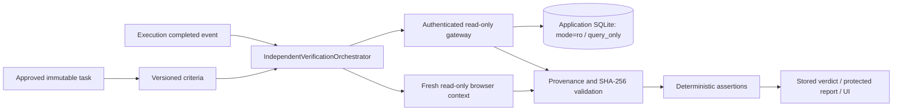

# Independent verification engine

Phase 5 implements `DEFINE SUCCESS → COLLECT EVIDENCE → VALIDATE → DECIDE → REPORT`.
The verifier accepts a read-only execution-history port. It has no action executor,
recovery port, SQL mutation interface or application write capability.

## Criteria and authority

`SuccessCriteriaEngine` recognizes the inventory status-change objective grammar
and checks the original manifest, plan snapshot and every action approval digest.
It extracts one asset identity and one approved select option. Unsupported goals
return `CRITERIA_REQUIRE_DEFINITION`; the implementation does not invent rules.
The default criteria check existence, status equality and persistence through two
fresh reads. A pre-execution baseline adds transition evidence and makes the
unrelated-inventory digest check mandatory. Without a baseline those two criteria
are optional and UNKNOWN; this limitation remains visible in the report.

Criteria are persisted before evaluation. Automatic verification prepares them
before execution begins, including a fresh baseline where available. Historical
executions can be verified without manufacturing a historical baseline. Expired
execution authorization cannot authorize new actions, but remains inspectable.
Explicit operator revisions append criteria to a new version with actor, reason,
expected previous version and a new digest. Existing mandatory criteria and the
baseline cannot be weakened or removed through the revision endpoint.

## Assertions

| Assertion | Semantics |
|---|---|
| equals / not_equals | Canonical typed comparison against persisted field |
| exists / not_exists | Record or field presence in a bounded database snapshot |
| contains | Case-sensitive string containment |
| state_transition | Intact pre-execution baseline, expected before/after, increasing version |
| record_persisted | Two distinct fresh request nonces, same store, identity, row and version |
| url_matches | Exact URL from the fresh read-only browser, no arbitrary regex |
| element_visible | Typed boolean from the fixed record DOM capture |

Conflicting fresh reads produce UNKNOWN. Screenshots, successful HTTP status,
execution flags and model statements cannot prove a persisted field. Evidence
requirements count distinct capture nonces, so copying one artifact cannot satisfy
a two-read persistence requirement.

One required FAIL produces VERIFIED_FAILURE. All required criteria PASS produces
VERIFIED_SUCCESS. Otherwise the verdict is INCONCLUSIVE. Optional criteria never
override mandatory criteria. An internal processing FAILED status has an
INCONCLUSIVE verdict; it is distinct from a completed verification proving failure.

## Lifecycle and reliability

The state machine persists CREATED, COLLECTING_EVIDENCE, EVALUATING and terminal
COMPLETED / INCONCLUSIVE / FAILED / CANCELLED states. Sessions use compare-and-swap
versions. The unique execution/criteria-version/idempotency-key tuple prevents
duplicate creation. Default key `terminal` joins automatic and manual requests.
Rechecking uses a new explicit key and gathers new evidence.

The collector brackets a fresh browser capture with two independent read-only
snapshots. Network retries are bounded and apply only to reads. Configured overall
timeouts and cancellation terminate collection; a process restart marks unfinished
sessions inconclusive (or processing-failed if never started), without replaying
application actions. Execution completion is saved before triggering verification.
Failure to start verification does not manufacture a positive outcome.

Events and state commit transactionally. Verification events project into the
existing authenticated execution WebSocket. REST event cursors and WebSocket
cursors are separate sequence domains; clients deduplicate by event UUID.

## Trust boundaries

`inventory-state` uses its own bearer capability, fixed SQL and an OS read-only
volume. No host port is published. Its internal network connects the backend,
browser worker and evidence service. Browser verification contexts allow only
GET/HEAD on the exact configured origin and reject mutation actions. The gateway
denies write verbs even with a valid capability. The ordinary worker has no Meta
key, application database mount or fault-administration token.

The gateway and application store are trusted sources. Hashes detect changed
artifacts relative to recorded metadata; they do not protect against a privileged
attacker rewriting both metadata and artifacts. There is no WORM storage,
cryptographic source attestation or exclusive causal attribution under concurrent
external writes. A later application change does not retroactively alter the
historical verdict.

## Reports and model support

Protected JSON and escaped HTML reports reconstruct the stored criteria, evidence,
results and historical verdict. Integrity is rechecked on report/artifact access.
Damaged or missing evidence changes `effective_verdict` to INCONCLUSIVE while
retaining `final_verdict` for audit. Archive access skips live freshness TTL only;
hash, scope, original chronology and provenance checks still apply.

Phase 5 needs no model call for deterministic inventory verification. Supplementary
Meta interpretation is not implemented. Existing Phase 2 reasoning and Phase 4
two-image recovery remain separate. The user explicitly deferred real model calls.

See [evidence model](EVIDENCE-MODEL.md), [API](API.md),
[measured scenarios](../benchmarks/reports/phase-05-verification.json) and
[Phase 5 report](PHASE-05-REPORT.md).
